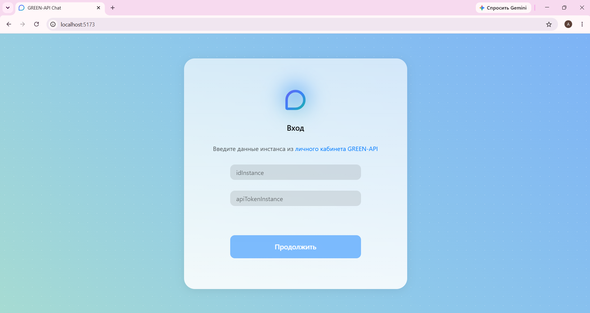
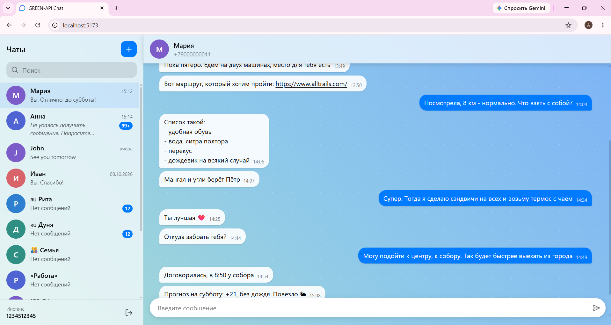
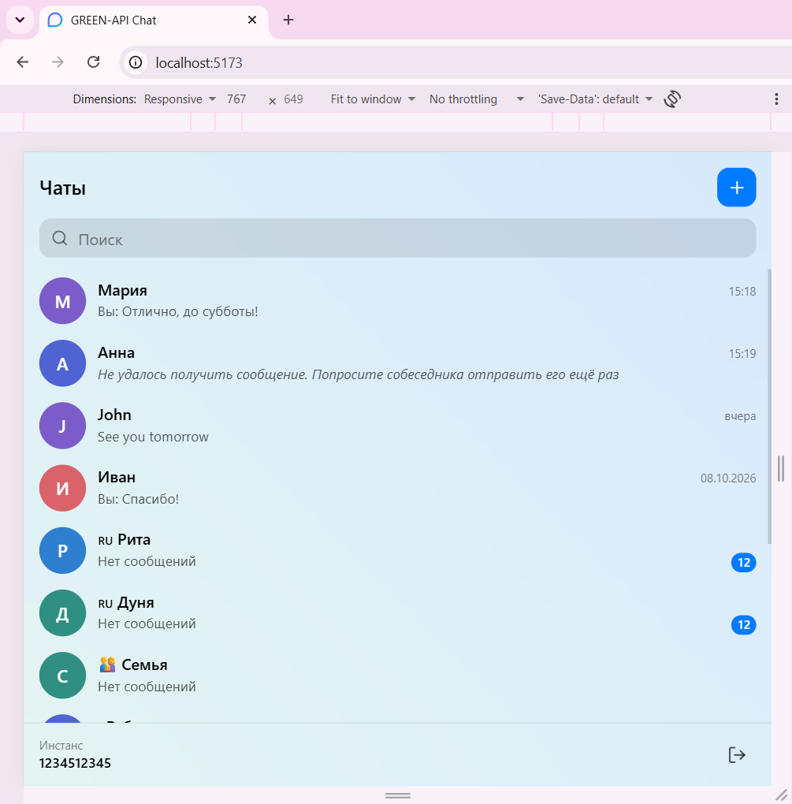
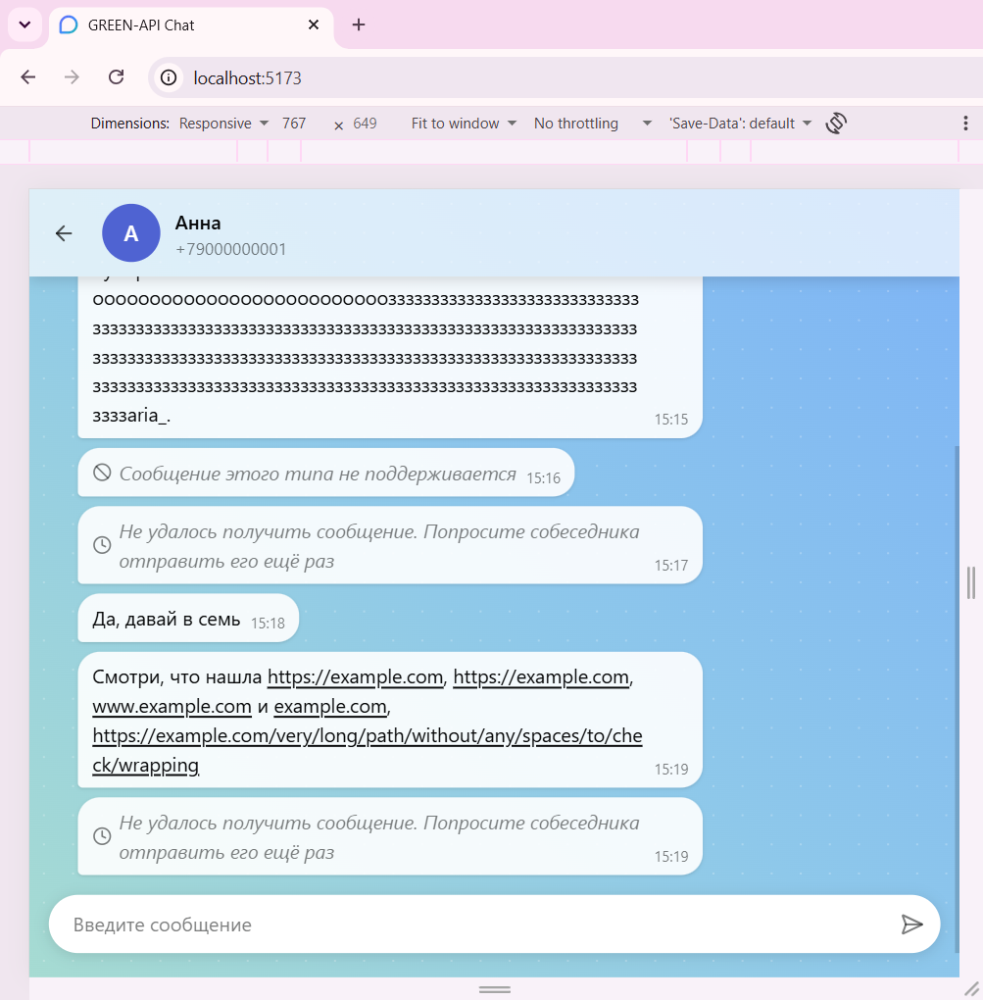

# GREEN-API Chat

[](https://green-chat-tsaiukova.netlify.app/)

Веб-чат для отправки и получения сообщений WhatsApp через [GREEN-API](https://green-api.com/).

Демо: [green-chat-tsaiukova.netlify.app](https://green-chat-tsaiukova.netlify.app/)

<details>
<summary>Скриншоты</summary>





<div>
  
  
</div>

</details>

## Возможности

- Вход по учётным данным GREEN-API (`idInstance`, `apiTokenInstance`) с проверкой статуса инстанса
- Создание нового чата по номеру телефона получателя
- Список чатов с поиском по имени и номеру
- Загрузка последних 20 личных чатов после входа, с состояниями «загрузка», «ошибка» и «пусто»
- Имена собеседников: из телефонной книги привязанного телефона, если номер там сохранён, иначе из профиля WhatsApp
- Отправка текстовых сообщений с индикатором отправки и обработкой ошибок
- Получение входящих сообщений в реальном времени (long polling через `receiveNotification` и `deleteNotification`)
- Счётчик непрочитанных, время сообщений, кликабельные ссылки
- Служебные плашки для неподдерживаемых типов сообщений и сообщений, которые не удалось расшифровать
- Адаптивная вёрстка: на узких экранах видна одна панель, в шапке чата есть кнопка «назад»

## Стек

- React 19
- TypeScript
- Vite
- Tailwind CSS

## Как запустить локально

Требуется Node.js 22.12+ (или 20.19+).

1. Склонируйте репозиторий, перейдите в папку проекта и установите зависимости:

```bash
git clone https://github.com/AlyaEngineer/green-api-chat.git
cd green-api-chat
npm ci
```

2. Создайте файл `.env` из примера:

```bash
cp .env.example .env
```

В командной строке Windows (cmd): `copy .env.example .env`.

3. Укажите в `.env` хост вашего инстанса. Его можно найти в [личном кабинете GREEN-API](https://console.green-api.com) в поле `apiUrl`:

```dotenv
VITE_INSTANCE_API_URL=https://1234.api.greenapi.com
```

Если оставить значение пустым, используется общий хост `https://api.greenapi.com`.

4. Запустите приложение:

```bash
npm run dev
```

Приложение откроется по адресу http://localhost:5173. После изменения `.env` перезапустите `npm run dev`.

## Как проверить

1. В личном кабинете GREEN-API создайте инстанс и привяжите к нему WhatsApp, отсканировав QR-код.
2. Введите `idInstance` и `apiTokenInstance` этого инстанса в форму входа.
3. Выберите чат из списка или нажмите «+» и введите номер собеседника, отправьте сообщение.
4. Ответьте с телефона собеседника: сообщение появится в чате.

На бесплатном тарифе GREEN-API можно переписываться не более чем с тремя номерами в месяц. Если отправка возвращает «Достигнут лимит тарифа GREEN-API», пишите тем номерам, с которыми инстанс уже переписывался.

## Команды

| Команда                | Что делает                                   |
| ---------------------- | -------------------------------------------- |
| `npm run dev`          | запуск в режиме разработки                   |
| `npm run build`        | проверка типов и сборка в папку `dist`       |
| `npm run preview`      | локальный просмотр собранной версии          |
| `npm run lint`         | проверка кода ESLint                         |
| `npm run format`       | форматирование кода Prettier                 |
| `npm run format:check` | проверка форматирования без изменения файлов |

## Ограничения

- Обрабатываются только входящие сообщения из личных чатов. Группы и сообщения, отправленные с привязанного телефона, не показываются.
- Ответы на сообщения показываются текстом, без цитаты.
- Сообщения хранятся в памяти и пропадают при перезагрузке страницы.
- У загруженных чатов нет истории: текст появляется, когда приходит или отправляется новое сообщение.
- Учётные данные не сохраняются: после перезагрузки нужно войти заново.
- Чат, созданный по номеру, показывает номер вместо имени, пока собеседник не напишет. Так WhatsApp отдаёт имена для новых переписок.
- Изменения в телефонной книге привязанного телефона могут доходить до GREEN-API с задержкой.

## Что можно сделать дальше

- Загрузка истории сообщений (`getChatHistory`)
- Прокрутка к первому непрочитанному сообщению
- Отображение исходящих сообщений, отправленных с телефона
- Роутинг, чтобы системная кнопка «назад» на телефоне закрывала чат
- Сохранение сессии между перезагрузками с безопасным хранением токена
- Мультиязычность интерфейса

## Использованные материалы

- Иконка приложения основана на [chat-teardrop](https://phosphoricons.com/) из набора [Phosphor Icons](https://github.com/phosphor-icons/core) (лицензия MIT), изменены толщина и цвет.
